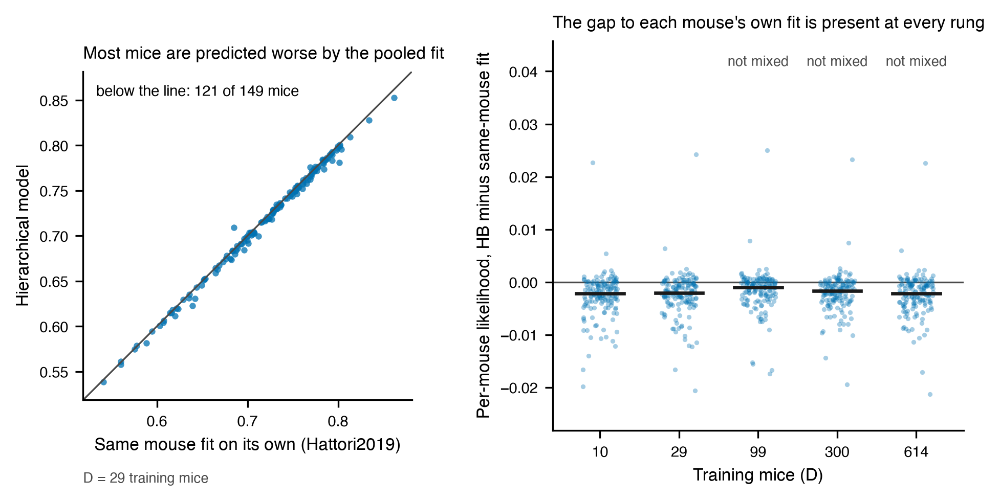

# Result 2 — Per mouse: HB against the same mouse's own classical-RL fit

<!-- BEGIN result-2 -->
[regenerated by `analysis/update_reports.py --report r2` from `analysis/per_mouse.py` output; do not edit by hand]

Held-out cohort: 149 mice. Pairing: same 149 held-out mice, joined by subject id, with equal per-mouse scored-trial counts (asserted); the individual trials are not compared, only their counts; difference = HB likelihood minus the mouse's own RL fit.

**Mice on which HB predicts worse than the same mouse's own fit** (median paired difference and Wilcoxon p are for the Hattori2019 fit, the same model family as HB):

| D | vs Hattori2019 (n mice) | median HB minus Hattori2019 | Wilcoxon p | vs Bari | vs compare-to-threshold | chains not mixed |
|---|---|---|---|---|---|---|
| 10 | 119 / 149 | -0.00215 | 8.3e-18 | 134 / 149 | 139 / 149 | no |
| 29 | 121 / 149 | -0.00203 | 4.1e-17 | 133 / 149 | 139 / 149 | no |
| 99 | 108 / 149 | -0.00100 | 1.2e-11 | 128 / 149 | 139 / 149 | yes |
| 300 | 120 / 149 | -0.00169 | 1.7e-16 | 133 / 149 | 139 / 149 | yes |
| 614 | 119 / 149 | -0.00213 | 4.5e-17 | 134 / 149 | 138 / 149 | yes |
<!-- END result-2 -->

## Reading

HB predicts the same mouse worse than that mouse's own Hattori2019 fit for most mice at every rung, and for even more mice against the Bari and compare-to-threshold fits. The aggregate gap in r1 is therefore not produced by a few mice: it is the typical direction.

The effect per mouse is small in absolute terms (the table gives the median paired difference in per-trial likelihood), which is why it matters that it holds for most mice and not just on average.

## Limits

- Mice are the unit of replication, and the paired test assumes they are independent. Mice share sessions and training conditions, which this analysis does not model.
- HB and the per-mouse fits are paired by subject id and have equal per-mouse scored-trial counts (asserted for every mouse). The tables carry counts, not trial identities, so that the individual trials are the same is not verified. The RL fits are the 2026-07-13 baseline runs from study 01, frozen in `analysis/ml_params/`.
- At the D = 99, 300 and 614 rungs the HB chains did not mix (r4), so those rows describe an unconverged fit and are marked.
- A per-mouse deficit that is largest for mice with the most trials would be the signature of a prior adding bias; that was not tested here and is not claimed.

## Provenance

- Producer `analysis/per_mouse.py`; frozen input and output under `analysis/`. The report region above is regenerated by `analysis/update_reports.py --report r2`.
- HB runs come from the pinned groups in `analysis/wandb_keys.py` (`analysis/hb_runs.json` is the frozen pull); each run's launch record is under `variants/one-stage-ladder/launch_record/`.
- Per-mouse RL fits: `analysis/ml_params/` (frozen from `/allen`, checksummed in `MANIFEST.json`); per-mouse HB likelihoods: `analysis/hb_per_subject_heldout.csv`.
- `status: draft`: written by Claude Science on the author's behalf and not yet reviewed.
