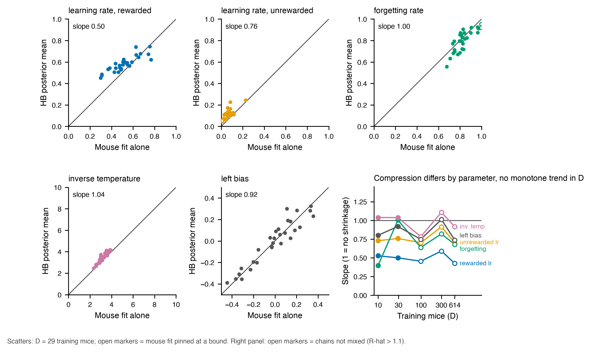

# Result 3 — Where HB pulls individual mice toward the population

<!-- BEGIN result-3 -->
[regenerated by `analysis/update_reports.py --report r3` from `analysis/shrinkage.py` output; do not edit by hand]

Exclusions from the primary slope: ML fits pinned at a rate bound (exactly 0 or 1) or with inverse temperature above beta_max=10. Slopes need at least 8 mice. `*` marks a rung whose chains are not mixed.

**Theil-Sen slope of the HB posterior mean on the mouse's own fit** (1 = individual differences preserved; below 1 = compressed toward the mean):

| parameter | D = 10 | D = 29 | D = 99 | D = 300 | D = 614 |
|---|---|---|---|---|---|
| learning rate, rewarded | 0.53 | 0.50 | 0.45* | 0.59* | 0.42* |
| learning rate, unrewarded | 0.73 | 0.76 | 0.70* | 0.91* | 0.70* |
| forgetting rate | 0.40 | 1.00 | 0.64* | 0.82* | 0.68* |
| inverse temperature | 1.04 | 1.04 | 0.78* | 1.11* | 0.92* |
| left bias | 0.80 | 0.92 | 0.75* | 1.01* | 0.74* |

**Spearman rank correlation between the two** (does HB order mice the way their own fits do):

| parameter | D = 10 | D = 29 | D = 99 | D = 300 | D = 614 |
|---|---|---|---|---|---|
| learning rate, rewarded | 0.68 | 0.88 | 0.82 | 0.82 | 0.67 |
| learning rate, unrewarded | 0.48 | 0.70 | 0.82 | 0.85 | 0.75 |
| forgetting rate | 0.77 | 0.79 | 0.83 | 0.85 | 0.84 |
| inverse temperature | 0.81 | 0.90 | 0.87 | 0.91 | 0.60 |
| left bias | 0.94 | 0.92 | 0.95 | 0.94 | 0.93 |

Mice entering each slope, shown for the rewarded learning rate (no exclusions apply to it): D = 10: 10/10, D = 29: 29/29, D = 99: 99/99, D = 300: 300/300, D = 614: 614/614. Other parameters lose mice to the exclusions, most at the unrewarded learning rate (pinned at 0) and forgetting rate (pinned at 1); the per-parameter counts are in `analysis/shrinkage.csv`.
<!-- END result-3 -->

## Reading

HB does not compress all five parameters equally. At the two rungs closest to mixed (D = 10 and 29) the rewarded learning rate has a slope near one half, so HB lets mice differ from the population on that parameter by about half as much as their own fits do. Inverse temperature is close to a slope of one at those rungs. The forgetting and unrewarded learning rates sit in between, with the forgetting rate varying most from rung to rung.

Rank agreement is high (second table): HB orders mice the way their own fits do. What it compresses is the size of the individual differences.

No parameter's slope is monotone in D, so these data do not show shrinkage growing or relaxing as the cohort grows.

## Limits

- Slopes use posterior means. At the D = 99, 300 and 614 rungs (marked `*`) the per-mouse chains did not mix, so those means come from unconverged fits and the slopes at those rungs are indicative only. D = 10 and 29 rest on 10 and 29 mice.
- The per-mouse fit is itself an estimate, with its own noise and with some fits pinned at a bound; those are excluded from the primary slope. Noise in the x variable biases a regression slope toward zero, so part of a slope below one is expected without any shrinkage. This analysis does not separate that part.
- The cohorts are nested (the D = 10 mice are in D = 29, and so on), so rungs are not independent samples.
- Whether a heavier-tailed prior on the rewarded learning rate would recover the lost accuracy is a hypothesis; it has not been tested.

## Provenance

- Producer `analysis/shrinkage.py`; frozen input and output under `analysis/`. The report region above is regenerated by `analysis/update_reports.py --report r3`.
- HB runs come from the pinned groups in `analysis/wandb_keys.py` (`analysis/hb_runs.json` is the frozen pull); each run's launch record is under `variants/one-stage-ladder/launch_record/`.
- Per-mouse HB posterior means: `analysis/hb_subject_posteriors.csv` (transform and input checksums in `analysis/hb_subjects_manifest.json`); per-mouse ML fits: `analysis/ml_params/`.
- `status: draft`: written by Claude Science on the author's behalf and not yet reviewed.
