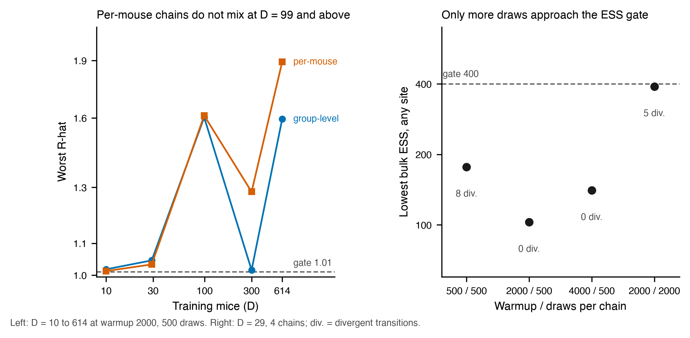

# Result 4 — Do the HB fits mix, what do sampler settings buy, and what does Stan cost

<!-- BEGIN result-4 -->
[regenerated by `analysis/update_reports.py --report r4` from `analysis/convergence.py` output; do not edit by hand]

Gates: no divergences, worst R-hat below 1.01, lowest bulk ESS at least 400.

**By training-cohort size** (warmup 2000, 500 draws, 4 chains; recomputed from each run's saved posterior):

| D | group-level worst R-hat | group-level lowest ESS | per-mouse worst R-hat | per-mouse lowest ESS | divergences |
|---|---|---|---|---|---|
| 10 | 1.018 | 355 | 1.012 | 232 | 6 |
| 29 | 1.045 | 142 | 1.032 | 103 | 0 |
| 99 | 1.602 | 7 | 1.611 | 7 | 0 |
| 300 | 1.015 | 240 | 1.283 | 11 | 0 |
| 614 | 1.595 | 7 | 1.892 | 6 | 0 |

**By sampler setting at D = 29** (warmup / draws per chain; worst and lowest over every group-level and per-mouse site):

| setting | worst R-hat | lowest ESS | divergences | passes all gates |
|---|---|---|---|---|
| 500 / 500 | 1.025 | 177 | 8 | no |
| 2000 / 500 | 1.045 | 103 | 0 | no |
| 4000 / 500 | 1.042 | 140 | 0 | no |
| 2000 / 2000 | 1.008 | 390 | 5 | no |

**Stan against NumPyro at D = 29**, 4 chains x (2000 warmup + 2000 draws), 8000 retained draws each; diagnostics on population_mean (the five population means); Stan's own definition:

|  | NumPyro | Stan |
|---|---|---|
| divergences | 5 | 23 |
| max R-hat (population means) | 1.0049 | 1.0030 |
| lowest bulk ESS (population means) | 899 | 1220 |
| ESS per retained draw | 0.112 | 0.153 |
| wall time (hours), as run | 6.35 | 14.72 |
| ESS per second | 0.039 | 0.023 |
| hardware | one GPU (Beaker) | 8 CPU cores, one chain per process (HPC) |

Relative to NumPyro, Stan's effective sample per draw is 1.36x, its wall time as run is 2.3x, and its effective sample per second is 0.59x.
<!-- END result-4 -->

## Reading

- **No finished HB run passes all three gates.** The closest are the two 2000-draw runs at D = 10 and D = 29, which pass the R-hat and ESS gates at D = 10 and miss ESS narrowly at D = 29, but both have divergent transitions.
- **At D = 99 and above the per-mouse chains do not mix, and the sampler flagged zero divergences.** Zero divergences does not rule out funnel or other posterior geometry; only R-hat and ESS were computed for these rungs, so the cause of the poor mixing is not identified here. The group-level sites at D = 300 are nearly mixed while the per-mouse sites are not.
- **The trainer's own diagnostics cover group-level sites only.** They would report D = 300 as acceptable. The recomputation here is what shows its per-mouse sites are not mixed.
- **Warmup and draws trade differently.** Raising warmup from 500 to 2000 removed the divergences at D = 29 but did not raise the lowest ESS (177 to 103); 4000 warmup raised it only modestly (140). Only more draws moved the lowest ESS toward the gate, and that brought divergences back.
- **Stan against NumPyro, like for like.** On the population means, with the same cohort and draw budget, Stan gives somewhat more effective sample per draw but took longer in wall time as run, on different hardware, so NumPyro delivered more effective sample per second. Both fail the divergence gate. The comparison is for D = 29 only: Stan has no completed fit at any larger cohort.

## Limits

- One seed per setting, so differences between warmup settings at D = 29 are within what seed variation could produce; this was not measured.
- R-hat and ESS here cover the group-level and per-mouse sites, not the session-level parameters.
- **Correction.** An earlier version of this report said Stan had 7.8x the effective sample per draw and 3.4x per second. Those used the R-hat and ESS the Stan trainer logged to W&B, which came from a chain-major reshape of PyStan's draw-major flat axis and so mixed the four chains. They are recomputed from the saved draws with the correct axis (`analysis/recompute_stan_diagnostics.py`); the wrong-axis computation reproduces the logged values exactly from the same draws. The Stan R-hat and ESS in `hb_runs.json` are the logged, wrong values and are not used.
- Stan's diagnostics are on the five population means only, so the Stan comparison uses the population-mean site of the NumPyro fit; an earlier figure that compared Stan's population-mean ESS with NumPyro's lowest ESS over all sites was not like for like and is superseded by this table.
- Wall time compares the two as the project ran them (one GPU against eight CPU cores), not the frameworks on equal hardware. Threading and slicing experiments on the Stan side were inconclusive and are recorded in `variants/stan-arm/launch_record/`; they are not results.

## Provenance

- Producer `analysis/convergence.py`; frozen input and output under `analysis/`. The report region above is regenerated by `analysis/update_reports.py --report r4`.
- HB runs come from the pinned groups in `analysis/wandb_keys.py` (`analysis/hb_runs.json` is the frozen pull); each run's launch record is under `variants/one-stage-ladder/launch_record/`.
- Stan arm: `variants/stan-arm/` (five launch records). NumPyro posterior summaries: `analysis/hb_posterior_summary.json`, from the posteriors listed in `analysis/hb_posterior_manifest.json`.
- `status: draft`: written by Claude Science on the author's behalf and not yet reviewed.
