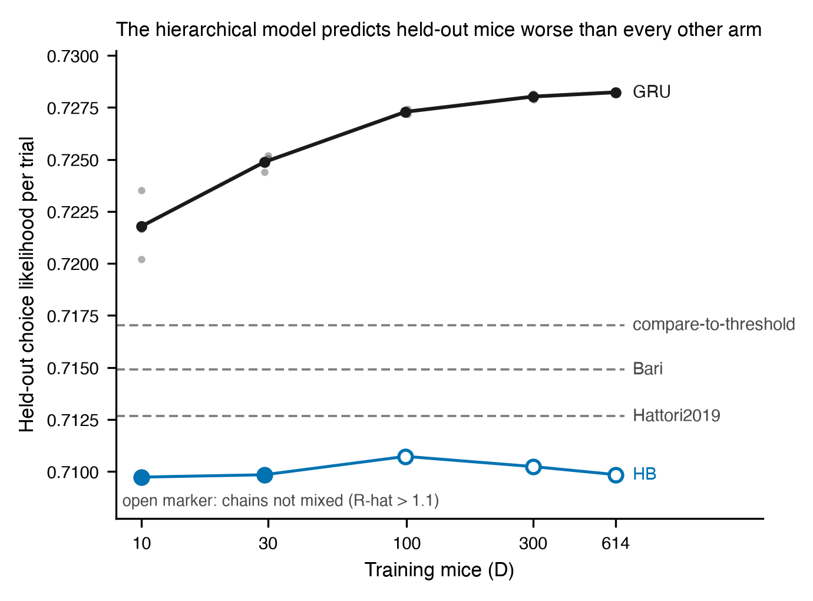

# Result 1 — Held-out likelihood: the hierarchical model against per-mouse RL and the GRU

<!-- BEGIN result-1 -->
[regenerated by `analysis/update_reports.py --report r1` from `analysis/three_arm.py` output; do not edit by hand]

Held-out cohort: 149 mice, 1,013,172 trials. Pooled trial-weighted per-trial choice likelihood (exp of mean log-likelihood over all held-out trials).

**Hierarchical model (HB) at each training-cohort size, against the GRU** (HB: one seed, warmup 2000, 500 draws, 4 chains; GRU: v2-sc-active, mean of its seeds):

| D | HB | GRU | GRU minus HB | HB max R-hat | HB divergences | R-hat <= 1.1? |
|---|---|---|---|---|---|---|
| 10 | 0.70973 | 0.72179 | +0.01206 | 1.018 | 6 | yes (still above the 1.01 gate) |
| 29 | 0.70984 | 0.72487 | +0.01503 | 1.045 | 0 | yes (still above the 1.01 gate) |
| 99 | 0.71073 | 0.72729 | +0.01656 | 1.611 | 0 | no |
| 300 | 0.71024 | 0.72802 | +0.01779 | 1.283 | 0 | no |
| 614 | 0.70985 | 0.72823 | +0.01838 | 1.892 | 0 | no |

**Classical RL, one fit per mouse (same 149 mice):** compare-to-threshold 0.71704, Bari 0.71491, Hattori2019 (the model HB uses) 0.71267.
<!-- END result-1 -->

## Reading

On the same 149 held-out mice, the hierarchical model (HB) predicts worse than every other arm at every training-cohort size: below the three per-mouse classical RL fits and below the GRU. Hattori2019 is the model HB is built on, fit here one mouse at a time, and it scores higher than HB. Fitting the same five-parameter model hierarchically therefore costs held-out accuracy in this comparison.

The GRU improves steadily as training mice are added. HB's value changes by about 0.001 across the rungs, but its three larger rungs did not mix (r4), so how HB depends on D cannot be read from them. The ordering does not depend on those rungs: the D = 10 and D = 29 rungs, the closest to mixed, are already below every other arm.

## Limits

- HB has one seed per rung, so there are no error bars on its points. The GRU points show its seeds.
- No HB rung passes the convergence gates (r4). Open markers mark rungs whose chains clearly did not mix; filled markers still fail the stricter 1.01 R-hat gate.
- The GRU and classical RL numbers are study 01's committed values (`studies/01-gru-scaling-law/scaling_results.csv` and `analysis/rl_baseline.json`). This report does not re-derive how the GRU adapts to a held-out mouse. Study 01 labels its cohort sizes 29/30, 99/101 and 300/301; they are matched here to the nearest HB rung.
- The GRU curve shown is the session-conditioned variant (`v2-sc-active`, three seeds; its hidden size is not recorded in the frozen inputs and is not stated here). The GRU few-shot curve is not shown: its committed values use a different aggregation from the pooled trial-weighted metric used here.

## Provenance

- Producer `analysis/three_arm.py`; frozen input and output under `analysis/`. The report region above is regenerated by `analysis/update_reports.py --report r1`.
- HB runs come from the pinned groups in `analysis/wandb_keys.py` (`analysis/hb_runs.json` is the frozen pull); each run's launch record is under `variants/one-stage-ladder/launch_record/`.
- GRU and classical-RL values: `studies/01-gru-scaling-law/` (committed there; this report reads them, it does not regenerate them).
- `status: draft`: written by Claude Science on the author's behalf and not yet reviewed.
